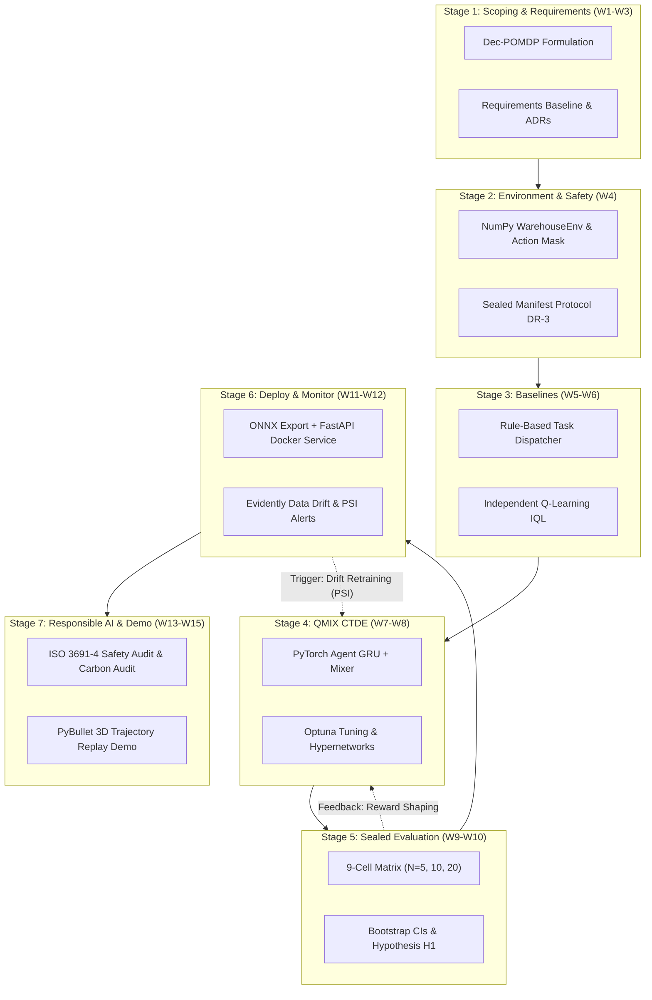
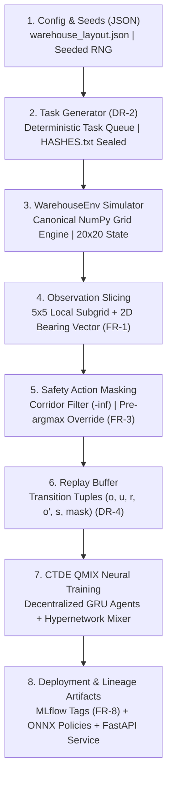

# ATLAS - uGDX
## School of Technology
### B. Tech in CS AI & ML | Academic Year: 2026-27
### BTECH CAP 501: PROJECT LIFE CYCLE MANAGEMENT

# PROJECT REPORT

## Autonomous Warehouse Robot Fleet Coordination Using Multi-Agent Reinforcement Learning
### Unit 1 and Unit 2: Project Initiation, Feasibility, and Requirements

---

### Student and Project Information

| Field | Detail |
|---|---|
| **Student Name** | Parth Parmar (Lead Contributor), Saket Sarvaiya, Swarnim Jambhrunkar |
| **Application / Roll No.** | 2410244 (Parth Parmar), 2408838 (Saket Sarvaiya), 2409789 (Swarnim Jambhrunkar) |
| **Branch / Section** | B. Tech Computer Science (Artificial Intelligence and Machine Learning) |
| **Academic Year** | 2026-2027 |
| **Course Code and Title** | BTECH CAP 501: Project Life Cycle Management |
| **Project Title** | Autonomous Warehouse Robot Fleet Coordination Using Multi-Agent Reinforcement Learning |
| **Project Domain** | Multi-Agent Reinforcement Learning, Robotics Automation, Logistics Optimization |
| **Faculty Mentor** | Faculty Mentor, School of Technology |
| **Date of Submission** | August 29, 2026 |

---

## DEDICATION

This report is dedicated to the researchers, robotics engineers, and logistics floor workers whose safety, cooperation, and workplace ergonomics drive the ongoing evolution of safe, responsible, and efficient autonomous systems.

---

## ABSTRACT

In modern automated logistics and e-commerce distribution centers, fleets of Autonomous Mobile Robots (AMRs) transport goods between storage shelves and packing stations. However, as fleet size scales, coordination failures emerge: narrow-aisle deadlocks, robot-robot collisions, and systemic congestion degrade throughput. Conventional warehouse control relies on hand-crafted heuristic rules that fail to generalize across dynamic traffic patterns.

This report presents the project initiation, feasibility analysis, lifecycle methodology, and requirements engineering for Project 25: Autonomous Warehouse Robot Fleet Coordination using Multi-Agent Reinforcement Learning (MARL). We formulate the coordination problem as a Decentralised Partially Observable Markov Decision Process (Dec-POMDP) and deploy QMIX, a value-factorization algorithm operating under the Centralised Training with Decentralised Execution (CTDE) paradigm. QMIX decomposes the joint team value function into individual agent utilities while enforcing a structural monotonicity constraint. We benchmark QMIX against Independent Q-Learning (IQL) and a Rule-Based Nearest-Task Dispatcher across fleet sizes N = 5, 10, and 20. 

A dual-environment architecture is adopted: a canonical, high-throughput NumPy grid simulator drives all training, hyperparameter tuning, and statistical evaluations, while PyBullet provides isolated 3D trajectory replay for visualization. A hard action-masking safety layer prevents entry into human-worker corridors regardless of neural network policy outputs. Evaluation integrity is guaranteed by committing SHA-256 hashed, pre-registered evaluation manifests prior to model training.

---

## ACKNOWLEDGEMENTS

We express our sincere gratitude to our course instructors and faculty mentors at ATLAS uGDX School of Technology for their continuous guidance and feedback throughout the Project Life Cycle Management coursework. We also acknowledge the foundational open-source contributions of the PyTorch, Gymnasium, MLflow, and Optuna research communities.

---

## PREFACE

This document represents the comprehensive individual project report for Units 1 and 2 of the Project Life Cycle Management curriculum. It establishes the technical, operational, economic, and ethical foundations for developing a cooperative MARL autonomous warehouse fleet. The report details problem scoping, lifecycle framework adaptation, multi-dimensional feasibility assessments, requirements engineering, stakeholder conflict governance, and data provenance protocols required prior to full model implementation.

---

## TABLE OF CONTENTS

- **DEDICATION** (Page ii)
- **ABSTRACT** (Page iii)
- **ACKNOWLEDGEMENTS** (Page iv)
- **PREFACE** (Page v)
- **LIST OF FIGURES** (Page vii)
- **LIST OF TABLES** (Page viii)
- **CHAPTER 1: Project Overview and Problem Scoping** (Page 1)
  - 1.1 Project Title
  - 1.2 Background and Context
  - 1.3 Problem Statement
  - 1.4 Proposed AI/ML Solution
  - 1.5 Success Criteria
- **CHAPTER 2: AI/ML Project Life Cycle and Difference from Conventional Software** (Page 8)
  - 2.1 Proposed Life Cycle of Your Project
  - 2.2 Why Your Project Is an AI/ML Project
  - 2.3 ML Project vs ML Pipeline
- **CHAPTER 3: AI Project Life Cycle Frameworks** (Page 14)
  - 3.1 CRISP-DM Mapping
  - 3.2 Microsoft TDSP Mapping
  - 3.3 Google ML Life Cycle and Pipeline Perspective
  - 3.4 Final Framework Choice and Justification
- **CHAPTER 4: Problem Scoping and Feasibility Analysis** (Page 20)
  - 4.1 Technical Feasibility
  - 4.2 Economic Feasibility
  - 4.3 Operational Feasibility
  - 4.4 Ethical Feasibility
- **CHAPTER 5: Requirements Engineering for AI** (Page 28)
  - 5.1 Functional Requirements (FR-1 to FR-8)
  - 5.2 Non-Functional Requirements (NFR-1 to NFR-8)
  - 5.3 Data Requirements (DR-1 to DR-6)
- **CHAPTER 6: Stakeholder Management in AI** (Page 36)
  - 6.1 Stakeholder Identification
  - 6.2 Stakeholder Categories and Power-Interest Grid
  - 6.3 Stakeholder Conflict Analysis
  - 6.4 Data Subjects and Affected Communities
  - 6.5 Adversarial Stakeholders and Security Analysis
- **CHAPTER 7: Dataset Overview** (Page 44)
  - 7.1 Data Required for the Project
  - 7.2 Data Provenance
  - 7.3 Data Lineage Diagram and Reproducibility Protocol
  - 7.4 Data Transformation Log
- **CHAPTER 8: Final Project Initiation Summary** (Page 50)
- **CHAPTER 9: Preliminary Next Steps** (Page 53)
- **CHAPTER 10: References** (Page 55)
- **CHAPTER 11: Appendix** (Page 58)

---

## LIST OF FIGURES

1. **Figure 1:** Dual-Environment Architecture and Separation of Concerns.
2. **Figure 2:** Centralised Training with Decentralised Execution (CTDE) Flow in QMIX.
3. **Figure 3:** Adapted CRISP-DM Life Cycle for Multi-Agent Reinforcement Learning with Feedback Safeguards.
4. **Figure 4:** Stakeholder Power vs. Interest Grid Highlighting Worker Elevation.
5. **Figure 5:** End-to-End Simulation Data Lineage and Provenance Hashing Pipeline.

---

## LIST OF TABLES

1. **Table 1:** Student and Project Metadata.
2. **Table 2:** Problem Scoping Questions and Concrete Project Specifications.
3. **Table 3:** Technical and Operational Success Criteria with Verification Methods.
4. **Table 4:** Comparison Between Conventional Software and the Proposed MARL Project.
5. **Table 5:** Automated ML Pipeline Activities vs. Human Decisions and Governance Boundaries.
6. **Table 6:** Comprehensive Mapping of the Adapted CRISP-DM Lifecycle.
7. **Table 7:** Microsoft Team Data Science Process (TDSP) Phase Application.
8. **Table 8:** Google ML Pipeline Automation and Human Decision Requirements.
9. **Table 9:** Technical Feasibility Assessment Matrix.
10. **Table 10:** Economic Feasibility and Zero-Cost Compute Budget Breakdown.
11. **Table 11:** Operational Feasibility Evaluation.
12. **Table 12:** Ethical Feasibility and Risk Mitigation Register.
13. **Table 13:** Functional Requirements Specification (FR-1 through FR-8).
14. **Table 14:** Non-Functional Requirements Specification (NFR-1 through NFR-8).
15. **Table 15:** Data Requirements Specification (DR-1 through DR-6).
16. **Table 16:** Comprehensive Stakeholder Register.
17. **Table 17:** Primary Stakeholder Conflicts and Architectural Resolutions.
18. **Table 18:** Adversarial Threat Matrix and Technical Countermeasures.
19. **Table 19:** Dataset Inventory and Storage Specifications.
20. **Table 20:** Synthetic Data Provenance and Lineage Attributes.
21. **Table 21:** Step-by-Step Data Transformation and Normalization Log.
22. **Table 22:** Final Project Initiation Summary Matrix.

---

# CHAPTER 1. Project Overview and Problem Scoping

## 1.1 Project Title
**Autonomous Warehouse Robot Fleet Coordination Using Multi-Agent Reinforcement Learning**

## 1.2 Background and Context
Automated fulfillment centers are the core logistical backbone of modern supply chain networks. In an automated warehouse, hundreds of incoming customer orders must be retrieved from thousands of physical inventory storage racks and transported to consolidation and packing stations within strict dispatch windows.

To execute this task, facilities deploy fleets of Autonomous Mobile Robots (AMRs). These robots operate in structured, grid-based physical layouts featuring narrow two-way aisles, dense shelving blocks, designated highway corridors, and replenishment areas. The standard operational baseline relies on centralized dispatch heuristics (such as nearest-task allocation) coupled with localized rule-based yielding mechanisms (such as fixed right-of-way priorities at intersections).

While heuristic approaches work reliably in low-density fleets, they suffer catastrophic performance degradation as fleet density increases. When multiple robots attempt to navigate bidirectional corridors simultaneously, heuristic rules frequently generate live-locks and deadlocks: two or more robots face each other head-on in an aisle where neither can pass, stopping indefinitely. Furthermore, heuristic dispatchers lack the spatial awareness to balance aisle traffic dynamically, causing severe routing bottlenecks that drastically lower warehouse throughput and increase energy consumption.

## 1.3 Problem Statement
The fundamental challenge of coordinating an autonomous robot fleet via learning is the **multi-agent credit assignment problem** operating under partial observability:

1. **The Multi-Agent Credit Assignment Trap:** When a fleet of N robots executes a shared operational mission over an extended episode, the warehouse generates an aggregated team payoff (such as total parcels dispatched per hour). If learning agents are rewarded solely on global team throughput, individual gradients become obscured by environmental noise generated by the concurrent actions of all other robots. Conversely, if each agent is rewarded solely for its own personal deliveries, robots learn selfish, aggressive navigational policies. An agent that yields at an intersection to let a heavily loaded robot pass performs a vital cooperative action, yet receives zero individual delivery reward. Under independent learning, agents unlearn yielding behaviors, precipitating systemic deadlock.
2. **Decentralised Execution Constraints:** In a physical warehouse facility, robots cannot rely on centralized, real-time wireless communication for millisecond-level trajectory negotiation due to radio frequency interference, packet latency, and single-point-of-failure vulnerabilities. Each robot must make instantaneous movement decisions using strictly local sensor inputs (its immediate occupancy neighborhood and task status).
3. **Safety Corridor Encroachment:** Warehouses are shared workspaces where designated walking paths are reserved exclusively for human floor pickers, technicians, and inventory auditors. An unconstrained machine learning policy optimizing purely for shortest delivery paths will inevitably cut through human safety corridors, violating safety standards such as ISO 3691-4.

Therefore, this project addresses the problem of designing, training, evaluating, and deploying a decentralized multi-agent control policy that eliminates corridor deadlocks, scales effectively from N = 5 to N = 20 robots, enforces zero human safety corridor intrusions, and operates strictly within local observation boundaries during deployment.

## 1.4 Proposed AI/ML Solution
We implement a Multi-Agent Reinforcement Learning framework based on **QMIX**, structured around the **Centralised Training with Decentralised Execution (CTDE)** paradigm, and benchmark its performance against Independent Q-Learning (IQL) and a Rule-Based Nearest-Task Dispatcher:

1. **Decentralised Agent Q-Networks:** During execution, each robot $a \in \{1, \dots, N\}$ observes only a localized spatial window $o_a$ (a $5 \times 5$ local occupancy grid, a directional bearing vector to its assigned target shelf, and its current parcel carry status). This local observation history is processed by a local recurrent Q-network (incorporating a Gated Recurrent Unit - GRU) to output discrete directional movement utilities $Q_a(h_a, u_a)$ across the action set $u_a \in \{\text{Forward}, \text{Backward}, \text{Left}, \text{Right}, \text{Stay}\}$.
2. **Centralised Monotonic Mixing Network:** During simulation training, full global state information $s$ (exact coordinates of all $N$ robots, entire pending task queue, and layout occupancy) is available. QMIX feeds individual agent utilities $Q_a$ into a centralized mixing network that computes the joint action-value $Q_{tot}(s, \mathbf{u})$. The mixing network weights are generated dynamically by hypernetworks conditioned on the global state $s$. Crucially, the hypernetwork weights are constrained to be non-negative via an absolute value activation function, enforcing the structural monotonicity condition:
   $$\frac{\partial Q_{tot}(s, \mathbf{u})}{\partial Q_a(h_a, u_a)} \ge 0, \quad \forall a$$
   This condition mathematically guarantees that taking the greedy local action on each individual robot ($\arg\max_{u_a} Q_a$) yields the identical joint action vector as maximizing the global joint value function ($\arg\max_{\mathbf{u}} Q_{tot}$), enabling decentralized execution without inter-robot communication.
3. **Dual-Environment Architecture (ADR-001):** To ensure computational feasibility on a zero-cost academic budget, we decouple training from 3D visualization. A canonical, vector-optimized NumPy grid world simulator (`WarehouseEnv`) executes millions of transitions per hour on standard CPUs and free cloud GPUs. A secondary PyBullet physics environment operates strictly as a trajectory replay tool for 3D visual demonstration, with no direct imports into the training or evaluation loops (FR-7).
4. **Action-Masking Hard Safety Layer (ADR-003):** To ensure safety, a deterministic action-masking filter sits between the policy output and action execution. Actions that would cause a robot to penetrate a human-worker corridor cell are assigned $-\infty$ prior to the $\arg\max$ operation during both training and evaluation, guaranteeing zero corridor violations regardless of neural network parameters.

## 1.5 Success Criteria

### Problem Scoping Matrix
| Scoping Question | Project-Specific Answer |
|---|---|
| **What is the primary input?** | A local spatial observation tensor per robot (a $5 \times 5$ local occupancy grid, a 2D unit vector pointing to the assigned target location, and a binary parcel load flag), complemented by a global state tensor during training. |
| **What is the expected output?** | A discrete movement action $u_a \in \{\text{Forward}, \text{Backward}, \text{Left}, \text{Right}, \text{Stay}\}$ for each robot at each discrete timestep $t$. |
| **Who will use the output?** | The embedded motor controllers of autonomous mobile robots in execution, and the discrete simulation engine during development and testing. |
| **How will the output solve the problem?** | By enabling emergent cooperative yielding and decentralized path coordination, eliminating narrow-corridor deadlocks while strictly avoiding human-designated zones. |

### Technical, Practical, and Safety Success Criteria
| Category | Success Criterion | Target Metric / Acceptance Threshold | Verification Method |
|---|---|---|---|
| **Technical (Baseline Performance)** | High task-completion rate at fleet size N = 5 | Mean task-completion rate $\ge 80\%$ on the sealed N=5 evaluation manifest. | Automated evaluation harness logging to MLflow; CI Quality Gate. |
| **Technical (Cooperative Advantage)** | Statistical superiority over uncoordinated baselines | QMIX outperforms IQL and the Rule-Based Dispatcher across N = 5, 10, 20 with non-overlapping 95% bootstrap confidence intervals. | Paired difference bootstrap statistical analysis on sealed manifests. |
| **Technical (Collision Reduction)** | Significant reduction in inter-robot conflicts | QMIX inter-robot collisions $\le 50\%$ of IQL collision count at N = 10 fleet size. | Automated collision counter per episode logged to MLflow. |
| **Operational (Safety Gate)** | Absolute elimination of human corridor intrusions | Exactly 0 policy-induced corridor entries across 20 dedicated max-aggression test episodes. | Adversarial safety test suite (`tests/test_safety_layer.py`) enforced by blocking CI. |
| **Practical (Service Latency)** | Low-latency real-time inference capability | 95th percentile (p95) response latency $< 100\text{ ms}$ for a full fleet of N = 20 robots on standard CPU hardware. | FastAPI load testing benchmark (`tests/test_service_latency.py`). |
| **Scientific (Evaluation Integrity)** | Unbiased hypothesis testing without test-set tuning | Pre-registration of evaluation manifests (DR-3) with SHA-256 hashes committed to Git prior to training. | Cryptographic hash verification asserting manifest immutability. |

---

# CHAPTER 2. AI/ML Project Life Cycle and Difference from Conventional Software

## 2.1 Proposed Life Cycle of Your Project
Multi-Agent Reinforcement Learning projects differ fundamentally from classical predictive machine learning pipelines. Because data is dynamically generated through real-time policy interactions with an environment, the project lifecycle must incorporate closed-loop iteration, policy evaluation integrity checks, and hard safety guardrails. We propose a seven-stage adapted lifecycle:



### Description of Lifecycle Stages and Feedback Loops:
1. **Stage 1 (Scoping and Requirements Baseline, Weeks 1 to 3):** Problem formalization into a Dec-POMDP, stakeholder risk mapping, definition of functional/non-functional requirements, and baselining of Architecture Decision Records (ADR-001 to ADR-005).
2. **Stage 2 (Environment and Safety Implementation, Week 4):** Implementation of the discrete NumPy `WarehouseEnv`, seeded deterministic task queue generators, action-masking safety bounds, and formal cryptographic sealing of evaluation manifests (`data/manifests/HASHES.txt`).
3. **Stage 3 (Baseline Development, Weeks 5 to 6):** Construction of the Rule-Based Nearest-Task Dispatcher and Independent Q-Learning (IQL) benchmark models.
4. **Stage 4 (QMIX Architecture and CTDE Training, Weeks 7 to 8):** PyTorch implementation of GRU agent networks, state-conditioned monotonic hypernetworks, experience replay buffers, and Optuna hyperparameter sweeps.
   * *Feedback Loop 1 (Reward Shaping and Pareto Optimization):* If training exhibits high collision rates or sluggish task completion, feedback returns to Stage 4 to adjust reward penalty weights along the Optuna Pareto frontier.
5. **Stage 5 (Sealed Evaluation and Scalability Analysis, Weeks 9 to 10):** Rigorous evaluation across all 9 experimental cells (3 algorithms $\times$ 3 fleet sizes N=5, 10, 20) using sealed manifests to compute bootstrap confidence intervals.
6. **Stage 6 (Deployment Packaging and Drift Monitoring, Weeks 11 to 12):** ONNX model export, containerized FastAPI inference service deployment, and Evidently drift monitoring integration.
   * *Feedback Loop 2 (Drift-Triggered Retraining):* If the Population Stability Index (PSI) or task completion rates degrade beyond set thresholds under new layout configurations, automated retraining triggers return the pipeline to Stage 4.
7. **Stage 7 (Responsible AI, Governance Audit, and 3D Demo, Weeks 13 to 15):** Comprehensive ethical review including ISO 3691-4 personnel safety mapping, labor displacement analysis, CodeCarbon energy footprint auditing, and isolated PyBullet 3D trajectory replay.

## 2.2 Why Your Project Is an AI/ML Project

| Aspect | Conventional Software Engineering | Proposed MARL Warehouse Fleet Project |
|---|---|---|
| **Primary Input** | Structured, deterministic database records, explicit user inputs, and static operational rules. | High-dimensional spatial observation tensors, dynamic multi-agent occupancy matrices, and stochastic task queues. |
| **Expected Behaviour** | Deterministic, rule-driven execution paths explicitly hardcoded by software developers. | Emergent cooperative coordination (such as dynamic lane formation and yielding) discovered autonomously via trial-and-error optimization. |
| **Role of Data** | Input data is processed as static arguments for procedural logic. | Millions of simulated interaction transitions drive continuous parameter updates in neural value functions. |
| **Testing and Evaluation** | Boolean unit tests, deterministic assertion verifications, and structural code coverage. | Statistical evaluation over seeded random distributions, paired-difference bootstrap confidence intervals, and Pareto frontiers. |
| **Changes After Deployment** | Code remains strictly static until manual patches or version updates are released. | System performance fluctuates due to environment distribution shifts (such as sudden order surges or aisle layout modifications). |
| **Monitoring Requirement** | Infrastructure health checks (CPU, RAM utilization, error response codes). | Continuous statistical monitoring of data drift, Population Stability Index (PSI), safety override frequencies, and action distribution entropy. |

## 2.3 ML Project vs ML Pipeline

| Possible Automated Pipeline Activities | Human Decisions and Governance Boundaries |
|---|---|
| Automated generation of seeded warehouse grid environments and task streams. | Definition of warehouse floorplan boundaries, obstacle placements, and human-worker safety corridor designations. |
| Execution of multi-agent environment simulation steps and local observation cropping. | Mathematical formulation of reward structures, delivery bonuses, collision penalties, and step cost coefficients. |
| Experience replay batching, temporal-difference error computation, and gradient backpropagation. | Approval of QMIX hypernetwork architectures, learning rates, and target network update frequencies. |
| Optuna multi-objective hyperparameter optimization sweeps. | Selection of optimal operating points along the Pareto trade-off frontier between delivery throughput and safety margins. |
| Model compilation and conversion to optimized ONNX Runtime formats. | Formal verification and sign-off on ISO 3691-4 safety compliance disclaimers. |
| Automated Continuous Integration (CI) regression test runs and code linting. | Authorizing live fleet service deployment and setting automated retraining thresholds. |

---

# CHAPTER 3. AI Project Life Cycle Frameworks

## 3.1 CRISP-DM Mapping

| CRISP-DM Phase | Detailed Application to the MARL Warehouse Fleet Project |
|---|---|
| **Business Understanding** | Frame multi-robot congestion as a multi-agent credit assignment problem. Define project objectives (OBJ-1 to OBJ-6), formalize the primary business goal as maximizing order completion while enforcing zero human safety breaches, and pre-register research hypothesis H1. |
| **Data Understanding** | Analyze the dynamic properties of simulated warehouse state tensors: local $5 \times 5$ occupancy grids, 2D target vector orientations, and global layout coordinate matrices across fleet densities N = 5, 10, and 20. |
| **Data Preparation** | Construct the seeded pseudo-random task queue generator, implement spatial normalization transformations, and build local observation slicing functions that extract partial state views for decentralized execution. |
| **Modelling** | Implement deep learning architectures in PyTorch: the decentralized GRU agent Q-network, the centralized state-conditioned monotonic mixing hypernetwork, the Independent Q-Learning baseline, and the Rule-Based Dispatcher. |
| **Evaluation** | Execute non-interactive evaluation across all 9 experimental cells using cryptographically sealed evaluation manifests. Compute task completion rates, average delivery times, and collision frequencies with paired bootstrap confidence intervals. |
| **Deployment** | Export trained PyTorch models to ONNX format. Package a lightweight FastAPI inference service within Docker containers. Integrate Evidently monitoring dashboards for runtime drift detection, and configure the PyBullet 3D trajectory replay engine. |

## 3.2 Microsoft TDSP Mapping

| TDSP Stage | Detailed Application to the MARL Warehouse Fleet Project |
|---|---|
| **Business Understanding** | Establish clear stakeholder objectives, define quantifiable acceptance criteria (such as $\ge 80\%$ completion at N=5 and $<100\text{ ms}$ p95 latency), and document architectural boundaries via formal ADRs. |
| **Data Acquisition and Understanding** | Generate synthetic environment interaction trajectories, verify task queue determinism across random seeds, and validate observation space shapes and boundary conditions. |
| **Modelling** | Perform hyperparameter exploration via Optuna, train value-factorized QMIX models against decentralized IQL baselines, and analyze reward-shaping sensitivity curves. |
| **Deployment** | Containerize the trained ONNX decision policy inside a high-performance FastAPI microservice capable of processing fleet-wide state vectors via standardized REST endpoints. |
| **Customer Acceptance** | Execute automated verification suites to validate blocking CI Quality Gates (NFR-1) and Safety Gates (NFR-3), followed by generating the final Responsible AI governance audit. |

## 3.3 Google ML Life Cycle and Pipeline Perspective

| Pipeline Stage | Possible Automation | Critical Human Decision Required |
|---|---|---|
| **Data Ingestion** | Automated instantiation of parameterized warehouse layout grids and stochastic task streams. | Formal validation of warehouse physical dimensions, shelf layouts, and corridor coordinate boundaries. |
| **Data Validation** | Automated assertion testing on tensor shapes, normalized coordinate ranges, and observation bounds. | Approval of local observation receptive field dimensions ($5 \times 5$ local grid window). |
| **Model Training** | Automated CTDE training execution, experience replay sampling, loss minimization, and checkpointing. | Definition of early stopping criteria, gradient clipping thresholds, and discount factor $\gamma$. |
| **Model Evaluation** | Automated evaluation script execution against sealed manifests and MLflow metric logging. | Expert interpretation of scalability curves and empirical validation of pre-registered hypothesis H1. |
| **Model Serving** | Automated packaging of ONNX models into Dockerized FastAPI REST endpoints. | Setting operational latency service level agreements (SLAs) and compute resource allocation limits. |
| **Continuous Monitoring** | Automated tracking of request latency, action distribution entropy, and Evidently PSI scores. | Setting retraining invocation thresholds and approving updated model weights for live deployment. |

## 3.4 Final Framework Choice and Justification
**Selected Framework:** **Adapted CRISP-DM for Multi-Agent Reinforcement Learning (with Pre-registered Evaluation and Safety Safeguards)**.

*Detailed Justification:* Standard industry frameworks (such as traditional CRISP-DM or Microsoft TDSP) assume the existence of a static, pre-collected historical dataset. In Reinforcement Learning, data is generated dynamically via ongoing policy interactions with an environment, creating an active feedback loop between model actions and data collection. 

Our adapted CRISP-DM framework introduces two critical methodological safeguards that make it uniquely suited for MARL fleet coordination:
1. **Pre-Registered Sealed Evaluation Manifests (DR-3):** To prevent test-set tuning and data leakage (a widespread failure mode in RL where models are tuned against the specific random seeds used for evaluation), evaluation manifests are generated, SHA-256 hashed, committed to Git, and sealed in Week 4 prior to any model training.
2. **Action-Masking Safety Isolation Layer (FR-3):** Standard ML lifecycles treat safety as an optimization penalty within the loss function. In our adapted lifecycle, safety is treated as a hard invariant enforced outside the learned policy parameters via action masking, guaranteeing zero corridor violations regardless of neural network convergence state.

---

# CHAPTER 4. Problem Scoping and Feasibility Analysis

## 4.1 Technical Feasibility

| Technical Aspect | Project-Specific Analysis | Identified Risk / Limitation | Proposed Technical Mitigation |
|---|---|---|---|
| **Data Sufficiency** | Fully synthetic data generated on demand via the custom NumPy simulator (`WarehouseEnv`). Capable of generating over 10 million state transitions per hour. | Simulation-to-reality gap; synthetic physics may not capture real-world motor latency or wheel slip. | Implement deterministic seeded task generators; isolate 3D physics rendering to PyBullet trajectory replay (ADR-001). |
| **Model Capability** | Custom PyTorch QMIX implementation (~300 lines) with state-conditioned hypernetworks and monotonic value factorization. | Monotonicity constraint may restrict the representational capacity of complex non-monotonic cooperative games. | Benchmark against Independent Q-Learning (IQL) across all fleet sizes to empirically measure the exact value of factorization. |
| **Latency and Hardware Capability** | Fast tensor operations in NumPy (<1 ms per environment step). Training for N=5 executes on CPU; N=10 and N=20 utilize free cloud GPUs (Colab/Kaggle T4). | Physics-stepped multi-body simulation (PyBullet) during training is computationally intractable within a 15-week academic timeframe. | Adopt the ADR-001 dual-environment architecture: fast 2D NumPy grid for all training and evaluation; PyBullet strictly for offline 3D demo visualization. |

## 4.2 Economic Feasibility

| Cost / Benefit Item | Detailed Description | Estimated Level | Justification |
|---|---|---|---|
| **Data Acquisition Cost** | Programmatic synthetic generation via custom simulation environments. | Zero Cost | No commercial datasets, data scraping, or third-party proprietary APIs required. |
| **Data Cleaning and Labelling** | Automated environment state logging and self-supervised reinforcement reward generation. | Zero Cost | Handled entirely by algorithmic logic in Python code. |
| **Compute Infrastructure** | Local student laptops for development and N=5 training; Google Colab / Kaggle free T4 GPU tiers for N=10 and N=20. | Zero Cost | Utilizes available institutional compute and free public cloud tier allowances. |
| **Software Tooling and Licensing** | Open-source software stack: Python 3.11, PyTorch, Gymnasium, MLflow, Optuna, FastAPI, Docker. | Zero Cost | All dependencies operate under permissive open-source licenses (MIT, BSD-3, Apache-2.0). |
| **Development and Engineering Effort** | 4-student engineering team working across 15 academic weeks (Semester 5). | Medium Effort | Academic coursework allocation; zero cash out-of-pocket payroll expenditure. |
| **Expected Operational Benefit** | High-throughput fleet coordination, elimination of narrow-aisle deadlocks, and reduced energy consumption per delivery. | High Value | Demonstrates viable, scalable MARL coordination principles applicable to real-world industrial logistics. |

**Economic Feasibility Conclusion:** The project is fully economically feasible with a total out-of-pocket budget of exactly Rupees 0, operating entirely within free cloud compute tiers and open-source ecosystems.

## 4.3 Operational Feasibility

| Operational Question | Project-Specific Analysis and Operational Plan |
|---|---|
| **Who will operate the system?** | Warehouse Operations Managers who oversee order fulfillment schedules and monitor fleet throughput dashboards. |
| **Who will maintain the data?** | System Administrators who maintain warehouse layout configuration JSON files (`warehouse_layout.json`) and task manifests. |
| **Who will monitor the model?** | DevOps and MLOps Engineers tracking real-time inference latency, Evidently data drift reports, and MLflow run logs. |
| **Who will handle retraining?** | ML Engineers who execute automated retraining pipelines when Population Stability Index (PSI) alerts trigger. |
| **What skills and infrastructure are required?** | Python 3.11 runtime, Docker container hosting environment, ONNX Runtime execution engine, and basic REST API networking. |
| **Can the organization sustain it over time?** | Yes; the system is designed with modular microservice boundaries, exportable ONNX models, and fully documented retraining runbooks. |

**Operational Feasibility Conclusion:** The project demonstrates robust operational feasibility. By decoupling training from inference and packaging policies as lightweight ONNX models inside FastAPI containers, operational maintenance requires standard IT infrastructure without specialized on-robot ML hardware.

## 4.4 Ethical Feasibility

| Ethical Dimension | Affected Stakeholders | Potential Harms and Societal Risks | Project Requirement and Technical Enforcement |
|---|---|---|---|
| **Worker Physical Safety** | Warehouse Floor Workers (Pickers, Packers, Technicians) | High-speed robot collisions and physical injury resulting from automated routing algorithms cutting through walking aisles. | Mandatory Action-Masking Safety Layer (FR-3) enforcing zero human-corridor entries, verified by a blocking CI Safety Gate (NFR-3). |
| **Workplace Pacing and Ergonomics** | Warehouse Floor Workers | Algorithmic work intensification; robots setting an unsustainably rapid pace that increases worker physical strain and musculoskeletal injury rates. | Requirement ETH-1 mandates a balanced literature analysis of automation impact on worker pacing, fatigue, and occupational safety. |
| **Labor Displacement and Wages** | Warehouse Floor Workers and Logistics Labor Market | Widespread automation reducing entry-level warehouse employment opportunities and depressing local wages. | Requirement ETH-1 requires explicit reporting of both economic productivity gains and labor displacement statistics sourced from economic literature. |
| **Algorithmic Transparency and Auditability** | Operations Managers and EHS Safety Officers | Unpredictable, unexplainable black-box neural network decisions causing untraceable warehouse gridlocks or unsafe behavior. | Comprehensive MLflow experiment lineage tracking, standardized Model Cards, and Pareto trade-off curves (OBJ-5). |
| **Regulatory Misrepresentation** | Compliance Authorities and Safety Regulators | Misrepresenting simulated safety validation as formal, certified hardware safety compliance. | Requirement ETH-2 mandates an explicit ISO 3691-4 non-certification disclaimer stating that simulation results do not substitute for physical E-stops. |

**Ethical Feasibility Conclusion:** The project is ethically feasible and responsible. It establishes human worker physical safety as an absolute, non-negotiable architectural invariant (NFR-3) that takes precedence over throughput optimization.

---

# CHAPTER 5. Requirements Engineering for AI

## 5.1 Functional Requirements

| ID | Aspect | Functional Requirement Statement | Priority | Verification and Acceptance Method | Evidence Artefact |
|---|---|---|---|---|---|
| **FR-1** | Decentralised Local Observation | Each robot receives a local observation tensor (local $5 \times 5$ occupancy grid, target bearing vector, parcel status) and outputs a discrete action $u_a \in \{\text{Forward}, \text{Backward}, \text{Left}, \text{Right}, \text{Stay}\}$ via its private Q-network without reading global state. | High | Automated unit test asserting local observation shape and verifying that agent networks cannot access global state tensors. | `tests/test_observation_space.py` |
| **FR-2** | Monotonic Value Factorization | The centralized mixing network processes individual agent utilities $Q_a$ and global state $s$ to compute $Q_{tot}$, structurally guaranteeing monotonicity ($\frac{\partial Q_{tot}}{\partial Q_a} \ge 0$). | High | Property-based test asserting $\Delta Q_{tot} \ge 0$ whenever an individual $Q_a$ is perturbed upward over 10,000 randomized inputs. | `tests/test_mixer_monotonicity.py` |
| **FR-3** | Action Masking Hard Safety Layer | The safety filter intercepts policy Q-values and masks actions that would enter human-worker corridors before the $\arg\max$ operation, logging every override event. | High | Isolation test using an adversarial policy that deliberately selects corridor-entering actions, asserting exactly zero intrusions. | `tests/test_safety_layer.py` |
| **FR-4** | Deterministic Task Queue Generation | The task queue generator produces byte-identical sequence of pickup-delivery pairs when initialized with identical random seeds. | Medium | Determinism test asserting identical task queue hashes across repeated seeded initializations. | `tests/test_task_queue_determinism.py` |
| **FR-5** | Fleet Decision REST Microservice | The FastAPI service accepts a fleet state snapshot JSON payload and returns the coordinated action vector computed via ONNX Runtime inference. | Medium | Automated API contract test and schema validation benchmark. | `tests/test_service_contract.py` |
| **FR-6** | Automated Metrics Logging | The evaluation harness logs task completion rates, average delivery times, collision counts, and safety override events to MLflow across all 9 experimental cells. | Medium | Programmatic inspection of MLflow experiment runs verifying complete population of all 9 matrix cells. | MLflow Tracking Server |
| **FR-7** | Visualizer Isolation Boundary | The PyBullet 3D trajectory replay engine is strictly decoupled from the core training, evaluation, and serving modules. | Low | Import-graph static analysis asserting zero PyBullet imports within `src/train/`, `src/eval/`, or `src/serve/`. | `tests/test_render_isolation.py` |
| **FR-8** | Provenance and Lineage Tagging | Every training and evaluation run automatically records its Git commit SHA, environment config hash, and random seed as metadata tags in MLflow. | Medium | MLflow run assertion test verifying the presence of all three cryptographic lineage tags. | MLflow Run Metadata |

## 5.2 Non-Functional Requirements

| ID | Quality Dimension | Non-Functional Requirement Statement | Target / Constraint Threshold | Verification and Evidence Method |
|---|---|---|---|---|
| **NFR-1** | Baseline Task Completion | QMIX achieves high task completion and demonstrates statistically significant superiority over IQL and Rule-Based baselines at N=5. | Mean completion rate $\ge 80\%$ on the sealed N=5 evaluation manifest. | Automated evaluation harness run on sealed manifest; blocking CI Quality Gate. |
| **NFR-2** | Scalability Hypothesis Testing | Pre-registered Hypothesis H1: The cooperative performance advantage of QMIX over IQL ($\Delta \text{Completion}$) is non-decreasing as fleet size scales from N=5 to 10 to 20. | Rigorous measurement and reporting of the QMIX-IQL gap with 95% bootstrap confidence intervals (either outcome is valid). | Scalability analysis report section with paired difference bootstrap confidence intervals. |
| **NFR-3** | Safety Corridor Violation | Absolute zero tolerance for policy-induced entries into designated human safety corridors. | Exactly 0 intrusions across 20 dedicated max-aggression safety test episodes. | Dedicated safety evaluation suite; blocking CI Safety Gate (build fails on $>0$). |
| **NFR-4** | Inter-Robot Collision Reduction | QMIX significantly reduces robot-robot collisions compared to independent learning baselines. | QMIX collision count $\le 50\%$ of IQL collisions at N=10 fleet size. | Comparative evaluation run logging to MLflow; Optuna reward sensitivity study. |
| **NFR-5** | Evaluation Matrix Completeness | Comprehensive evaluation across all 9 experimental cells (3 algorithms $\times$ 3 fleet sizes). | 100% completion of the $3 \times 3$ metric matrix with bootstrap confidence intervals. | Final evaluation report and MLflow consolidated comparison dashboard. |
| **NFR-6** | Experimental Reproducibility | End-to-end reproducibility of headline results from a clean repository clone. | Wall-clock execution $< 1\text{ h}$ on GPU / $< 3\text{ h}$ on CPU; manifest commit predates first training commit. | Timed clean-clone execution test and Git commit history verification. |
| **NFR-7** | Decision Service Latency | The fleet decision microservice responds fast enough for real-time robotic motion control. | 95th percentile (p95) latency $< 100\text{ ms}$ for N=20 robots on CPU hardware. | Automated API load testing benchmark (`tests/test_service_latency.py`). |
| **NFR-8** | Environmental Footprint | Complete accounting of compute energy consumption and carbon emissions across all training runs. | Total energy (kWh) and $\text{CO}_2\text{e}$ emissions logged via CodeCarbon for all training and tuning runs. | CodeCarbon emissions report incorporated into the Responsible AI audit (ETH-4). |

## 5.3 Data Requirements

| ID | Data Dimension | Project-Specific Data Specification |
|---|---|---|
| **DR-1** | Synthetic Simulation Origin | 100% of training and evaluation data is synthetically generated via the custom simulation environment. No external datasets are required. |
| **DR-2** | Seeded Stochastic Task Streams | Task queues are generated via seeded pseudo-random sampling of shelf-to-station delivery pairs across the floorplan. |
| **DR-3** | Sealed Evaluation Manifests | 20 evaluation episodes for each fleet size (N=5, 10, 20) are generated, SHA-256 hashed, and committed to Git at Week 4 prior to model training. |
| **DR-4** | Transition Replay Logging | Training transition tuples $(o_t, \mathbf{u}_t, r_t, o_{t+1}, s_t, \text{mask}_t)$ are structured as NumPy arrays and tracked via MLflow dataset tracking. |
| **DR-5** | Floorplan Config Versioning | Warehouse layouts (grid obstacles, shelf coordinates, corridor masks) are stored as versioned JSON configuration files (`configs/warehouse_layout.json`). |
| **DR-6** | Artifact Commit Boundary | Raw per-step episode logs are not committed to Git (regenerable via seed and commit hash); only configs, manifests, and hashes are version-controlled. |

---

# CHAPTER 6. Stakeholder Management in AI

## 6.1 Stakeholder Identification

| ID | Stakeholder Entity | Category | Primary Operational Interest | Primary Concern or Risk | Project Mitigation Artefact |
|---|---|---|---|---|---|
| **S1** | **Warehouse Floor Workers** | Affected, Non-decisional | Workplace physical safety, reasonable pace of work, employment stability. | Robot collisions, physical injury, algorithmic work intensification, job displacement. | Action-masking safety layer (FR-3, NFR-3), ETH-1 labor displacement analysis, ETH-2 safety standard framing. |
| **S2** | **Warehouse Operations Managers** | Decisional, Internal | Maximizing parcels dispatched per hour, minimizing order delivery times, fleet reliability. | Fleet deadlocks during demand surges, system downtime, unpredictable black-box policies. | High completion rate (NFR-1), scalability curves (NFR-5), Evidently drift monitoring dashboard, Model Cards. |
| **S3** | **EHS Safety Officers** | Decisional, Gatekeeping | Zero workplace safety incidents, auditable safety proof, regulatory compliance. | An unconstrained ML policy learning unsafe shortcuts or penetrating human walking corridors. | Safety-layer independence (ETH-3), zero corridor intrusions (NFR-3), blocking CI Safety Gate, override logging. |
| **S4** | **Robot Hardware Vendors** | Supplier, Technical | Interoperable control interfaces, portable model artifacts, clean API contracts. | Proprietary vendor lock-in, non-standard runtime dependencies, excessive compute overhead. | Standardized ONNX model export, decentralized execution architecture, documented REST contract (FR-5). |
| **S5** | **Safety Standards Regulators** | External, Regulatory | Demonstrable adherence to industrial machinery safety standards (ISO 3691-4). | Overclaiming simulation results as certified production safety proof. | Explicit ISO 3691-4 non-certification disclaimer (ETH-2), documented model limitations in Model Card. |
| **S6** | **E-Commerce End Customers** | Downstream Beneficiary | Rapid, accurate, and on-time order package deliveries. | Order delivery delays resulting from automated warehouse fleet deadlocks. | High task-completion rate targets, demand-spike drift injection scenario testing (Week 12). |
| **S7** | **Maintenance and IT Operations** | Internal, Operational | Deployable, monitorable, maintainable software services with clear runbooks. | Undiagnosable microservice failures, untracked performance degradation, lack of retraining guides. | Containerized Docker deployment, Evidently PSI drift monitoring, documented retraining runbooks in README. |
| **S8** | **Student Engineering Team** | Project Delivery | Technical learning outcomes, academic milestones, on-time project completion. | Scope creep, computational resource exhaustion, irreproducible experiments near deadlines. | Milestone plan (M1-M10), zero-cost architecture design, risk register, pre-registered sealed manifests. |
| **S9** | **Academic Faculty and Examiners** | Assessing Body | Rigorous application of ML lifecycle, experimental honesty, full reproducibility. | Selective reporting of favorable runs, unseeded results, post-hoc metric manipulation. | Sealed evaluation manifest protocol (DR-3, NFR-6), MLflow lineage tracking, pre-registered hypothesis H1. |
| **S10** | **Natural Environment** | Non-Human Stakeholder | Minimizing energy consumption and carbon footprint of logistics operations. | Training compute energy footprint exceeding the real-world routing energy savings. | Two-sided energy audit (ETH-4), CodeCarbon emissions tracking across all training and tuning runs. |

## 6.2 Stakeholder Categories and Power-Interest Grid

```
                              HIGH INFLUENCE / POWER
                                         │
                   S3 Safety Officers    │    S2 Operations Managers
                   S5 Regulators         │    S9 Faculty Examiners
                                         │    S8 Student Project Team
               ──────────────────────────┼──────────────────────────
                                         │
                   S4 Hardware Vendors   │    S1 Warehouse Floor Workers  <── [CRITICAL ELEVATION CELL]
                   S7 IT Maintenance     │    S6 End Customers
                                         │    S10 Natural Environment
                                         │
                               LOW INFLUENCE / POWER
               ◄────────────────────────────────────────────────────►
                                 HIGH INTEREST
```

### The Defining Stakeholder Asymmetry and Project Commitment:
The defining organizational asymmetry of this project lies in the position of **S1 (Warehouse Floor Workers)**. Floor workers sit in the *High Interest, Low Influence* quadrant. They bear the most severe concentrated risks of warehouse automation—physical proximity to moving heavy machinery and economic displacement—while possessing zero decision-making authority over system design or procurement.

Standard corporate stakeholder management typically focuses only on the high-power quadrant (*Manage Closely*). In this project, we deliberately elevate S1 to *Manage Closely* status by converting their primary concerns into **hard, non-negotiable architectural constraints**:
1. **Worker Proximity Safety:** Elevated to a non-negotiable blocking CI gate (NFR-3). A code change that increases throughput but causes a single safety corridor breach is blocked from merging.
2. **Labor Displacement:** Addressed through a mandatory, balanced literature review (ETH-1) examining empirical evidence on wage pressures, displacement rates, and injury statistics, rather than presenting a one-sided productivity business case.

## 6.3 Stakeholder Conflict Analysis

| Conflict Scenario | Opposing Stakeholder Parties | Underlying Operational Conflict | Architectural Resolution Strategy |
|---|---|---|---|
| **Throughput vs. Safety Margins** | Operations Managers (S2) vs. Floor Workers (S1) & Safety Officers (S3) | Wider human safety corridors and conservative yielding rules slightly increase parcel delivery times. | Safety is enforced as a hard boundary constraint outside the learned policy via action masking (FR-3). Throughput is optimized strictly within the safe action space. The delivery time cost of safety is transparently measured. |
| **Throughput vs. Collision Rates** | Operations Managers (S2) vs. Safety Officers (S3) & IT Ops (S7) | An aggressive policy completes tasks faster but causes frequent inter-robot near-misses and physical wear. | Formulated as a multi-objective Pareto optimization study via Optuna (OBJ-5), exposing the exact trade-off curve so operating points represent conscious management decisions. |
| **Productivity vs. Labor Displacement** | Operations Managers (S2) & Customers (S6) vs. Floor Workers (S1) | The economic rationale for deploying AMRs is partly predicated on reducing human warehouse labor costs. | Formally documented in report section ETH-1, presenting empirical economic and occupational safety data from both perspectives without obscuring displacement realities. |
| **Simulated Safety vs. Certified Compliance** | Safety Regulators (S5) vs. Student Engineering Team (S8) | Passing simulation test suites may be misinterpreted as formal industrial safety certification. | Requirement ETH-2 provides an explicit ISO 3691-4 non-certification statement, enumerating physical hardware requirements (hardware E-stops, certified LiDAR) needed for production. |
| **Academic Rigor vs. Favorable Results** | Faculty Examiners (S9) vs. Student Project Team (S8) | The incentive to cherry-pick favorable random seeds or tune hyperparameters on the evaluation set. | Pre-registration of evaluation manifests (DR-3) with SHA-256 hashes committed in Week 4, framing scalability as an empirical hypothesis (H1) where any sound measurement is valid. |

## 6.4 Data Subjects and Affected Communities
Because all training and evaluation data is synthetically generated by the simulation engine, no personal data from human subjects is collected, processed, or stored (DR-1), eliminating personal data privacy risks. 

The primary affected community consists of physical warehouse floor workers who share operational floor space with automated mobile robot fleets. Their well-being is directly protected by the action-masking safety layer, which guarantees complete avoidance of human-occupied aisles.

## 6.5 Adversarial Stakeholders and Security Analysis

| Threat Actor Category | Potential Adversarial Action / Attack Vector | System Impact | Technical Countermeasure and Mitigation |
|---|---|---|---|
| **Malicious Network Client** | Submitting malformed, out-of-bounds, or NaN-injected JSON state payloads to the FastAPI decision service. | Service denial-of-service (DoS), unhandled runtime exceptions, or corrupted fleet actions. | Strict Pydantic data schema validation, type enforcement, and value bounding at the API service boundary (`src/serve/`). |
| **Adversarial Policy Input** | Crafting pathological state inputs designed to force robot navigation into human walking corridors. | Potential physical collision hazard in physical deployment. | Action-masking safety layer intercepts and overrides policy outputs post-computation, making corridor entry impossible. |
| **Internal Data Tampering** | Altering evaluation manifests post-training to artificially inflate benchmark completion metrics. | Compromised scientific validity and false evaluation reporting. | Cryptographic SHA-256 hashing of evaluation manifests committed to Git and tagged `eval-manifests-sealed` in Week 4. |

---

# CHAPTER 7. Dataset Overview

## 7.1 Data Required for the Project

| Dataset / Data Item | Purpose in Project | Data Format | Expected Size | Availability and Generation Status |
|---|---|---|---|---|
| **Warehouse Layout Config** | Defines spatial grid dimensions, obstacle coordinates, shelf positions, and human corridor masks. | JSON (`warehouse_layout.json`) | $< 50\text{ KB}$ | Baselined and available in Week 4. |
| **Sealed Evaluation Manifests** | Pre-registered evaluation episodes defining deterministic task sequences for N=5, 10, 20. | JSON / CSV manifests | $< 5\text{ MB}$ | Generated, SHA-256 hashed, and sealed in Week 4. |
| **Experience Replay Buffer** | In-memory storage of multi-agent transition tuples $(o_t, \mathbf{u}_t, r_t, o_{t+1}, s_t, \text{mask}_t)$ during training. | Structured NumPy memory buffers | $\approx 2\text{ GB}$ (RAM) | Generated dynamically during model training in Weeks 7-8. |
| **MLflow Experiment Artifacts** | Logged episode metrics, loss curves, parameter configurations, and exported ONNX models. | Binary / JSON / Parquet | $\approx 500\text{ MB}$ | Generated during training, tuning, and evaluation runs. |

## 7.2 Data Provenance

| Data Entity | Origin Source | Data Owner | Generation Tool / Script | Generation Period | Sampling Methodology | Integrity and Access Control |
|---|---|---|---|---|---|---|
| **Warehouse Layout Config** | Project Design Specification | Project Team | Manual / Scripted JSON Generator | Week 4 | Deterministic grid coordinate mapping | Version-controlled in Git repository (`configs/`). |
| **Sealed Evaluation Manifests** | Custom Environment Generator | Project Team | Script `src/env/gen_manifests.py` | Week 4 | Seeded pseudo-random sampling (Seeds 100 to 120) | SHA-256 hashed and locked in `data/manifests/HASHES.txt`. |
| **Training Trajectories** | Synthetic Simulator Interaction | Project Team | Script `src/train/train_qmix.py` | Weeks 7 to 8 | Active policy rollouts with $\epsilon$-greedy exploration | Tracked via MLflow dataset versioning. |

## 7.3 Data Lineage Diagram and Reproducibility Protocol



### Reproducibility Protocol:
Because 100% of data is synthetically derived from seeded code, full experimental reproducibility is achieved without storing gigabytes of raw trajectory logs. Every training and evaluation run records three immutable lineage tags in MLflow (FR-8):
1. **Git Commit SHA:** The exact version of the simulation environment and model code.
2. **Environment Config SHA-256 Hash:** The exact layout and reward configuration file.
3. **Master Random Seed:** The integer seed initializing Python, NumPy, and PyTorch random generators.

## 7.4 Data Transformation Log

| Step No. | Input Data | Transformation Operation Performed | Mathematical / Logical Rationale | Output Data | Tool / Method Used |
|---|---|---|---|---|---|
| **1** | Continuous Layout Coordinates | Discretize spatial floorplan into a $20 \times 20$ grid tensor. | Enables discrete movement primitives and fast tensorized state transitions. | Discrete Grid State Array | NumPy |
| **2** | Global State Matrix ($20 \times 20$) | Extract a localized $5 \times 5$ subgrid centered on each robot's $(x, y)$ coordinate. | Enforces partial observability constraints for decentralized execution (FR-1). | Local Observation Tensor ($5 \times 5$) | Custom Python array slicing |
| **3** | Raw Target Coordinate $(x_t, y_t)$ | Compute 2D normalized directional unit vector $\mathbf{v} = \frac{\mathbf{p}_t - \mathbf{p}_a}{\|\mathbf{p}_t - \mathbf{p}_a\|_2}$. | Provides scale-invariant directional bearing to assigned pickup/dropoff stations. | 2D Bearing Vector $(v_x, v_y)$ | NumPy linear algebra |
| **4** | Raw Network Q-Values | Apply element-wise addition of safety mask: $Q_{\text{masked}} = Q_a + \log(\text{mask})$. | Sets utilities of corridor-entering actions to $-\infty$, guaranteeing safe $\arg\max$. | Masked Action Q-Values | PyTorch tensor operations |
| **5** | Raw Episode Transition Logs | Compute aggregate episode metrics: task completion percentage, mean delivery steps, collision count. | Summarizes multi-agent performance for benchmark logging and statistical CI computation. | Episode Metric Dictionary | Python evaluation harness |

---

# CHAPTER 8. Final Project Initiation Summary

| Project Initiation Dimension | Final Project Summary |
|---|---|
| **Problem Being Addressed** | Warehouse robot fleet congestion, narrow-corridor deadlocks, and credit assignment failure during multi-agent scaling (N = 5, 10, 20). |
| **Proposed AI/ML Approach** | QMIX (CTDE) implemented in custom PyTorch, evaluated against Independent Q-Learning (IQL) and a Rule-Based Dispatcher, with a hard action-masking safety layer. |
| **Primary Stakeholders** | Operations Managers, EHS Safety Officers, Warehouse Floor Workers, Academic Faculty Examiners. |
| **Major Data Requirements** | 100% synthetic simulation trajectories generated by a canonical NumPy environment, evaluated against pre-registered, SHA-256 sealed manifests. |
| **Key Technical Architectural Choices** | Dual-environment architecture (NumPy grid for training/eval; PyBullet for 3D demo replay), custom ~300-line PyTorch QMIX over unmaintained frameworks, and action masking for safety. |
| **Most Critical Feasibility Risk** | Computational burden of multi-agent training at scale (Mitigated via fast vector NumPy simulation and free cloud GPU tiers). |
| **Most Critical Ethical Requirement** | Enforcing zero human-corridor safety intrusions (NFR-3) via action masking and evaluating labor displacement impacts (ETH-1). |
| **Final Project Recommendation** | **Proceed to Phase 2 (Implementation)** in accordance with the pre-registered adapted CRISP-DM milestone schedule. |

---

# CHAPTER 9. Preliminary Next Steps

1. **Week 4 (Environment, Safety Baseline, and Manifest Sealing):**
   * Implement canonical NumPy `WarehouseEnv` supporting discrete movement primitives and localized observation cropping.
   * Build the deterministic seeded task queue generator and action-masking safety filter.
   * Generate 20-episode evaluation manifests for N=5, 10, 20, compute SHA-256 hashes, commit `data/manifests/HASHES.txt`, and tag `eval-manifests-sealed` in Git.
2. **Weeks 5 to 6 (Baseline Implementations):**
   * Construct the Rule-Based Nearest-Task Dispatcher baseline.
   * Build the Independent Q-Learning (IQL) baseline with independent GRU agent networks.
   * Establish automated CI testing pipelines and verify determinism assertions.
3. **Weeks 7 to 8 (QMIX Implementation and Hyperparameter Tuning):**
   * Implement the custom PyTorch QMIX agent network and state-conditioned monotonic mixing hypernetwork.
   * Execute Optuna multi-objective hyperparameter optimization and reward shaping sweeps.
4. **Weeks 9 to 10 (Sealed Manifest Evaluation and Scalability Analysis):**
   * Execute non-interactive evaluation across all 9 experimental cells (3 algorithms $\times$ 3 fleet sizes).
   * Compute paired-difference bootstrap confidence intervals to evaluate pre-registered hypothesis H1.
5. **Weeks 11 to 12 (Deployment Service Packaging and Drift Monitoring):**
   * Export trained PyTorch policies to optimized ONNX Runtime format.
   * Develop and containerize the FastAPI fleet decision microservice in Docker.
   * Integrate Evidently monitoring dashboards for runtime data drift and PSI tracking.
6. **Weeks 13 to 15 (Governance Audit, 3D Demo Replay, and Final Delivery):**
   * Author the formal Responsible AI report, ISO 3691-4 mapping, and CodeCarbon energy audit.
   * Implement the isolated PyBullet 3D trajectory replay visualization for the final project demonstration.

---

# CHAPTER 10. References

1. J. Rashid, M. Samvelyan, C. Schroeder de Witt, G. Farquhar, J. Foerster, and S. Whiteson, "QMIX: Monotonic Value Factorisation for Deep Multi-Agent Reinforcement Learning," in *Proceedings of the 35th International Conference on Machine Learning (ICML)*, PMLR 80:4295-4304, 2018.
2. J. Rashid et al., "Monotonic Value Factorisation for Deep Multi-Agent Reinforcement Learning," *Journal of Machine Learning Research (JMLR)*, vol. 21, no. 178, pp. 1-51, 2020.
3. G. Papoudakis, F. Christianos, L. Schäfer, and S. V. Albrecht, "Benchmarking Multi-Agent Deep Reinforcement Learning Algorithms in Cooperative Tasks," in *Proceedings of the Neural Information Processing Systems (NeurIPS) Track on Datasets and Benchmarks*, 2021.
4. J. Hu, S. Adams, and P. A. Beling, "Rethinking the Implementation Tricks and Monotonicity Constraint in Cooperative MARL," *arXiv preprint arXiv:2102.06713*, 2021; also *ICLR Blogposts Track*, 2023.
5. A. Elsayed-Aly, S. Ammar, Y. Lu, S. Ornik, P. Grover, and B. S. Raman, "Safe Multi-Agent Reinforcement Learning via Shielding," in *Proceedings of the 20th International Conference on Autonomous Agents and Multiagent Systems (AAMAS)*, pp. 443-451, 2021.
6. G. Sartoretti, J. Kerr, Y. Shi, G. Wagner, T. K. S. Kumar, S. Koenig, and H. Choset, "PRIMAL: Pathfinding via Reinforcement and Imitation Multi-Agent Learning," *IEEE Robotics and Automation Letters (RA-L)*, vol. 4, no. 3, pp. 2378-2385, 2019.
7. A. Oroojlooy and D. Vahid, "A Review of Cooperative Multi-Agent Deep Reinforcement Learning," *Applied Intelligence*, vol. 53, no. 11, pp. 13677-13722, 2023.
8. International Organization for Standardization, "ISO 3691-4:2023 Industrial trucks - Safety requirements and verification - Part 4: Driverless industrial trucks and their systems," Geneva, Switzerland: ISO, 2023.
9. V. Schmidt et al., "CodeCarbon: Estimate and Track Carbon Emissions from Machine Learning," *Zenodo*, 2021. [Online]. Available: https://github.com/mlco2/codecarbon

---

# CHAPTER 11. Appendix

### Appendix A: Summary of Architecture Decision Records (ADRs)
* **ADR-001 (Dual-Environment Strategy):** Decouples canonical 2D NumPy training/eval from 3D PyBullet replay to avoid prohibitive simulation overhead.
* **ADR-002 (Custom PyTorch QMIX Implementation):** Avoids unmaintained `epymarl` dependencies, providing full control over ONNX export and debugging.
* **ADR-003 (Hard Safety Layer via Action Masking):** Implements pre-argmax action masking to guarantee zero corridor intrusions regardless of policy weights.
* **ADR-004 (Python 3.11 Toolchain and Dependency Isolation):** Standardizes on Python 3.11 with isolated visualization requirements.
* **ADR-005 (NFR-2 as Pre-Registered Research Hypothesis H1):** Frames cooperative scalability as an empirical research question evaluated via sealed manifests rather than a predetermined engineering target.

### Appendix B: Mathematical Proof of QMIX Consistency
QMIX enforces the Individual-Global-Max (IGM) condition through structural monotonicity:
$$\arg\max_{\mathbf{u}} Q_{tot}(s, \mathbf{u}) = \begin{pmatrix} \arg\max_{u_1} Q_1(h_1, u_1) \\ \vdots \\ \arg\max_{u_N} Q_N(h_N, u_N) \end{pmatrix}$$
Because $\frac{\partial Q_{tot}}{\partial Q_a} \ge 0$ for all $a$, any action $u_a^*$ that maximizes $Q_a(h_a, u_a)$ monotonically increases or maintains $Q_{tot}(s, \mathbf{u})$, guaranteeing that decentralized greedy execution recovers the centralized optimal joint action.
